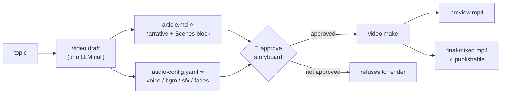
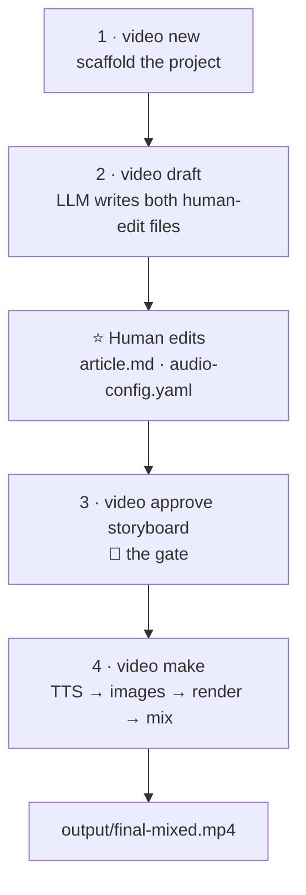
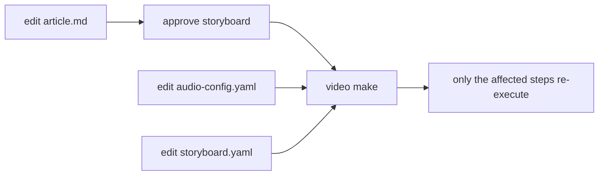

# AI Video Factory — Usage

How to turn a topic into a finished 1080p video.

- **Not installed yet?** → [`docs/INSTALLATION.md`](./INSTALLATION.md)
- **You want the system design?** → [`docs/architecture.md`](./architecture.md)
- **You want the storyboard format reference?** → [`docs/schema.md`](./schema.md)

This document covers: the workflow, the human gates, editing and recovery,
audio, images, publishing, and the file layout.

> **About command blocks.** This document describes what each step does and
> why, without pasting shell transcripts. Every step names the exact command
> to run, so you can type it yourself. For copy-paste-runnable blocks and
> the offline demo, see the Quickstart in [`README.md`](../README.md).

---

## 1. The core idea

The system's whole interface is **two AI commands and one human approval**.

One LLM call writes both human-edit files at once. A human reads and
approves. One command renders the video. Everything else in this document
is detail on those three moves.



The two starred files are the **only** things a human edits. Every other
file in a project is derived from them.

The approval gate is not advisory. Until the storyboard is approved,
`video make` fails at the render step and prints the exact approve command.
Calling `video preview --force` bypasses it, and the bypass is recorded in
the audit trail.

---

## 2. The recommended workflow

Four commands, two human edits, one output.



### 2.1 Scaffold

`video new <id>` creates the project directory with its skeleton: the
storyboard template, empty asset folders, the run and checkpoint
directories, the output directory, and the workflow state file.

The project starts in the `DRAFT` state. Workflow state lives in
`state.yaml`; every tool call leaves a record under `runs/`.

### 2.2 Draft

`video draft <topic>` is the single LLM call. It writes:

- **`article.md`** — the narrative, plus a `Scenes` block that defines every
  scene's narration and visuals.
- **`audio-config.yaml`** — the voice, the BGM tag, the SFX cues, and the
  fades.

It also derives `storyboard/storyboard.yaml` (the VDSL form of the article),
so the video's length follows the audio rather than a separate guess.

`video draft` runs the audio-planning step on the fresh article
automatically. Two guardrails matter:

- `--no-audio-plan` skips that step, giving you only the article.
- An existing `audio-config.yaml` is **never** overwritten — hand edits win.
  The command prints a note pointing at `video audio-plan` when it kept one.

If the audio-planning LLM call fails, the draft still succeeds, because
`article.md` is the primary artifact. The failure surfaces as a hint to run
`video audio-plan` separately.

To start from your own idea rather than a blank topic, pass `--file <path>`
with a text or markdown file. The LLM treats it as a **major idea and
opinions seed**: it polishes wording, structure, and flow, but must not
change any opinion you expressed. (`--from` instead revises an existing
draft; the two are mutually exclusive.)

#### Frontmatter that changes rendering

Beyond the basics (`project`, `language`, `duration_target_sec`, `voice`),
these keys in `article.md` change what the render produces:

| Key                       | Effect                                                                  |
| ------------------------- | ----------------------------------------------------------------------- |
| `image_style`             | The preset used for scene-image briefs (`editorial`, `flat-vector`, …)  |
| `image_provider`          | Which image API `video make` uses                                       |
| `theme`                   | The storyboard theme, written by `--style`                              |
| `require_visual_approval` | When true, `video make` refuses to render until the image set is frozen |
| `captions_source`         | What the caption overlay burns in: `narration` (default) or `caption`   |
| `no_captions`             | When true, no caption overlay at all                                    |

> **Use `captions_source: caption` for English articles.** The overlay is
> validated against the bottom safe area — three lines of 24 CJK units, with
> ASCII counting as half — which caps an English scene near 144 characters.
> English narration runs 150–220 per scene, so the default `narration`
> source fails validation on nearly every scene and the render is refused.
> The `caption` source burns the scene's short `caption:` label instead,
> which passes at any language and stops a designed card's own text from
> being printed twice beneath itself.

### 2.3 Approve

Read `article.md` — it is mirrored into `storyboard.yaml`, so what you
approve is what renders. Then `video approve storyboard --cwd <project>`.

### 2.4 Make

`video make <project>` runs the whole render in one command: text-to-speech,
audio assets, scene images, the per-scene renders, and the final mix. It is
**idempotent** — a step whose output is newer than its inputs is skipped, so
re-running after an edit only re-executes what the edit affected.

Useful flags:

| Flag                                                   | Effect                                                            |
| ------------------------------------------------------ | ----------------------------------------------------------------- |
| `--dry-run`                                            | Print what would run and what would be skipped, without executing |
| `--fake`                                               | Fully offline: silent placeholder audio and no AI images          |
| `--image-provider mock\|minimax\|openai\|gemini\|none` | Choose the image backend; `minimax` is the default                |
| `--bgm-dir <dir>`                                      | Use your own BGM library instead of the mock placeholder          |
| `--sfx-dir <dir>`                                      | Use your own SFX library                                          |

`--fake` is the canonical offline mode. It skips both text-to-speech
(writing silent placeholder WAVs) and real image generation, and scenes
stay as `AnimatedIllustration` — caption plus animated SVG — so the video
is visible end to end without any network access. Pass `--image-provider
mock` explicitly only when you want to exercise the `ImageBackground` path
with placeholder images.

#### Resolving the project argument

Every verb that takes a project argument resolves it the same forgiving way,
in order:

1. A direct path to a project root.
2. The exact folder name under `projects/`.
3. The human topic, slugified and case- and separator-insensitive — so
   `"Harness Engineering"`, `harness_engineering`, and
   `harness-engineering` all find the same project.
4. A unique folder-name prefix.

An ambiguous prefix errors listing the candidates. A zero-match error lists
every available project.

#### What lands on disk

| Output                                | What it is                                           |
| ------------------------------------- | ---------------------------------------------------- |
| `output/preview.mp4`                  | The visual preview                                   |
| `output/preview-faststart.mp4`        | The same, with faststart metadata for streaming      |
| `output/final-mixed.mp4`              | Narration + BGM + SFX — **the publishable artifact** |
| `assets/audio/scene_*.wav`            | Per-scene text-to-speech                             |
| `assets/audio-assets/{bgm,sfx}/*.wav` | BGM and SFX assets                                   |
| `captions/<lang>.srt`                 | Subtitles                                            |
| `qa/render-report.json`               | The QA report, written on every render               |
| `qa/contact-sheet.png`                | A per-scene contact sheet for quick human review     |
| `scenes/`                             | The per-scene MP4 cache                              |

Rendering is **scene-isolated**: each scene renders to its own MP4 fragment
first, then the fragments are concatenated. Editing scene 7 re-renders only
scene 7. `video preview --draft` renders the low-quality tier (960×540 at
15fps) into a separate cache; the final output stays 1080p30.

Every render ends with a QA report summary covering duration, fps,
resolution, audio, black frames, assets, scene audio-sync, captions, and
scene boundaries. Error-level findings fail the step.

---

## 3. The human gates

Gates are workflow state, not a chat-style "please confirm".

| Gate       | Command                    | What it blocks                                                                                                    |
| ---------- | -------------------------- | ----------------------------------------------------------------------------------------------------------------- |
| Storyboard | `video approve storyboard` | `video preview` and `video make`'s render step refuse without it (`--force` bypasses, and the bypass is recorded) |
| Review     | `video approve review`     | `video final` refuses without it                                                                                  |
| Final      | `video final` (QA gate)    | Error-level QA findings block the export (`--force` bypasses, and the bypass is recorded)                         |

There is also a **stage guard**: generator verbs (`research`, `script`,
`storyboard`, `audio`, `motion`) refuse to overwrite a human-approved stage
or a `FINAL_APPROVED` project without `--force`, which prints as a warning.

The typical iteration loop:



Editing the narrative re-runs text-to-speech and the render. Editing only
the audio configuration re-runs the audio assets and the mix. Editing one
scene's component re-runs only that scene's render, because the scene cache
reuses every other fragment.

`video make`'s publishable artifact is `final-mixed.mp4`. Projects on the
full agent pipeline end with `video final`, behind the QA and review gates.

---

## 4. The scene-level loop

The scene is the minimal editable unit, and every scene carries version
history.

| Command                                              | Effect                                           |
| ---------------------------------------------------- | ------------------------------------------------ |
| `video scene list <project>`                         | Versions per scene, with the approved one marked |
| `video scene approve <project> <scene-id>`           | Persist which version you approved               |
| `video scene restore <project> <scene-id> <version>` | Roll one scene back to an earlier version        |

This is the point of the whole system: a 24-scene video where you dislike
scene 9 costs one scene's re-render, not the whole video.

### 4.1 Remotion Studio live preview

`video studio <project>` opens the project in Remotion Studio — a live,
browser-based preview with a timeline and input-props editing. The Studio
workspace is regenerated from the storyboard on each launch, so re-run it
after editing the storyboard to refresh the composition.

The Studio server prints its URL (`Server ready - Local: http://localhost:3000`)
and does **not** open a browser on its own — the Remotion CLI would otherwise
open a tab in your default browser. Pass `--open` to auto-open it.

The generated workspace is a real Remotion project, so anything Studio can
do (props editing, frame scrubbing) works against the pipeline's exact
render implementation. It is the fastest way to iterate on visuals before
rendering any MP4.

### 4.2 Recovery

| Command                          | Effect                                                                                                                                                                           |
| -------------------------------- | -------------------------------------------------------------------------------------------------------------------------------------------------------------------------------- |
| `video resume`                   | Make-flow projects re-run the idempotent pipeline; CLI-flow projects print the state and the exact next command                                                                  |
| `video rollback <checkpoint-id>` | Validates the id, marks downstream checkpoints invalidated, lands at `DRAFT` or the target stage. Never overwrites artifacts — content restores go through `video scene restore` |
| `video reset [stage] [--force]`  | Rewind. Marks the target checkpoint invalidated instead of faking an approval                                                                                                    |

### 4.3 About hand-editing `storyboard.yaml`

`storyboard.yaml` is derived from `article.md` and is refreshed on every
`video draft` run. `video make` also rewrites each scene's `duration:` field
after text-to-speech, to match the actual measured audio length — without
that, the renderer would use the article's planned duration and freeze on a
still frame when audio played past it.

So if you hand-edit `storyboard.yaml` (swapping to the `Image` component,
tweaking props):

- Per-scene `duration:` and other `video draft`-derived fields are
  overwritten on the next `video draft`.
- The per-scene `duration:` is also overwritten on the next `video make`,
  since it re-measures audio.
- Everything else survives — component choice, props, subtext — because the
  duration sync only touches the `duration:` line.

Two supported flows:

- **Editorial tweaks** → edit `article.md`, then `video draft` regenerates
  `storyboard.yaml` cleanly.
- **Pixel-level art direction** → hand-edit `storyboard.yaml`, then run
  `video make` directly. Do **not** re-run `video draft` until you are ready
  to lose those tweaks.

---

## 5. The storyboard and VDSL format

The schema accepts versions `0.1` and `0.2`; all 0.2 fields are optional and
both validate. The authoritative reference is
[`docs/schema.md`](./schema.md) — the implementation is zod in strict mode,
so unknown keys are rejected everywhere and validation errors carry YAML
line numbers.

Durations are in **seconds**; the compiler converts them to frames by
rounding the product of duration and frame rate.

### 5.1 The shape of a storyboard

A storyboard is a project block, an optional style block, an optional asset
manifest, and a list of scenes. Each scene carries an id, a duration, its
narration, its visual, its animations, its caption settings, and its
transitions.

The full annotated example lives in [`docs/schema.md`](./schema.md). The
rules that bite most often:

- `schema_version` must be `0.1` or `0.2` (defaults to `0.2` when omitted).
- Scene ids must be unique. Each scene needs a positive `duration` and a
  registered visual component.
- Components must be in the registry, and their props must pass that
  component's own schema.
- The narration audio file must exist and must not exceed the scene
  duration (with 0.05 s tolerance). `video preview` and `video make` sync
  durations to the measured audio before validating, so run one of them
  first.
- Captions must wrap to at most three lines of 24 CJK units — the bottom
  safe area.
- Timeline animations must fit inside the scene: start plus duration must
  not exceed the scene's own duration.
- LLM synonyms are coerced before validation (`wipe` becomes `draw`,
  `hand-drawn` becomes `canvas`, `dissolve` becomes `fade`). Truly unknown
  values fail loudly.

### 5.2 Renderer families

| `visual.renderer` | Components                     | Notes                                    |
| ----------------- | ------------------------------ | ---------------------------------------- |
| `remotion`        | Any classic registry component | The default                              |
| `canvas`          | `DoodleScene`                  | Hand-drawn ink, seeded wobble, beat-sync |

Unwired renderer and component combinations fail loudly at render time.

### 5.3 Themes

`style.theme` selects one of nine built-in colour palettes. The default is
**`paper-light`**. Unknown or missing values also fall back to
`paper-light`, so a render never crashes on a typo — and `video validate`
surfaces a hint when an unknown name appears.

Set it with `--style <name>` on `video draft`, or write it directly into
the `style:` block. `video theme` prints the palette index with swatches,
`video theme <name>` prints one palette, and `video theme --cwd <root>`
resolves a project's current theme.

<!-- BEGIN: theme-table (generated by `pnpm run docs:commands` — do not edit) -->

| `style.theme`      | Background   | Accent         | Mood / best for                                                              |
| ------------------ | ------------ | -------------- | ---------------------------------------------------------------------------- |
| `paper-light`      | warm paper   | orange         | **default (v0.4.3)** — hand-drawn / bright office / pairs with `DoodleScene` |
| `dark-tech`        | deep navy    | blue           | tech explainers (default prior to v0.4.3)                                    |
| `ocean-deep`       | calm teal    | teal           | calm/technical, monitoring topics                                            |
| `dusk-warm`        | plum         | coral          | story-led, soft brand                                                        |
| `forest-moss`      | emerald      | lime           | sustainability / outdoor / botanical                                         |
| `sunset-pop`       | near-black   | yellow         | energetic consumer / entertainment                                           |
| `terminal-vintage` | CRT phosphor | phosphor green | dev tutorials, retro/hacker nostalgia (JetBrains Mono throughout)            |
| `paper-cream`      | beige        | burnt orange   | product / food / family-friendly                                             |
| `ai-red`           | player dark  | red `#FF0000`  | creator/playback feel — pairs with the `channel-banner` intro gradient       |

<!-- END: theme-table -->

The full palette table is in [`docs/schema.md`](./schema.md).

---

## 6. Voice, subtitles, and audio

### 6.1 Everything is subsumed into `video make`

The recommended path has no separate audio step. `video make` synthesizes
narration, resolves the BGM and SFX cues, writes the subtitles, and mixes
everything into `final-mixed.mp4`.

### 6.2 Inter-sentence pauses

Set `pause_between_sentences_sec` in `audio-config.yaml` to insert a pause
between sentences. The value is part of the text-to-speech cache key, so
changing it re-synthesizes the affected scenes rather than serving stale
audio.

### 6.3 Voice selection

The `voice:` key in `audio-config.yaml` names the voice, and
`tts_provider:` names the backend:

| Provider           | What `voice:` means                                 | Requirements                                                                                      | Speed                                                       |
| ------------------ | --------------------------------------------------- | ------------------------------------------------------------------------------------------------- | ----------------------------------------------------------- |
| `voicebox`         | A Voicebox profile name or id                       | A local voicebox-server (`VOICEBOX_URL`, default `127.0.0.1:17493`)                               | Qwen3-TTS, roughly 7× slower than realtime on Apple Silicon |
| `minimax`          | A MiniMax `voice_setting.voice_id`                  | `MINIMAX_API_KEY`. Voice cloning needs a pay-as-you-go key — Token Plan keys fail with error 2061 | Roughly 2.5× faster than realtime                           |
| omitted, or `edge` | An Edge TTS voice id, such as `zh-CN-YunjianNeural` | None — the free Edge endpoint                                                                     | Roughly realtime                                            |

Edge TTS is the default because it needs no key and no local service.

### 6.4 Narrating with a cloned voice (Voicebox)

Set `tts_provider: voicebox` in the article's frontmatter and point
`voice:` at a Voicebox voice profile. The provider talks to a local
voicebox-server, polls the async job, and writes the returned WAV; the
duration sync then rewrites scene lengths to the measured audio.

Qwen3-TTS 1.7B on Apple Silicon synthesizes roughly 7× slower than realtime.
Budget about 20 minutes of machine time per 180 seconds of narration — paid
once per narration edit, because the cache is namespaced by provider.

### 6.5 BGM and SFX

The tag in `audio-config.yaml` (`bgm: calm`, `sfx: {scene_1: whoosh}`)
resolves to a file of that name in the `--bgm-dir` or `--sfx-dir` you passed
— exact name first, then any `.wav` whose name contains the tag.

Without those flags, the audio-assets step writes a one-second **silent
mock placeholder**. The mix machinery still runs — you are just ducking
silence. With the flags, real audio lands in `assets/audio-assets/` and the
mix layers it under the narration, ducked by roughly 18 dB. A sibling
`.license.txt` file is recorded on the make report so provenance stays
visible. A missing tag fails the audio-assets step readably: add the file
or drop the cue.

BGM has no provider service. Tags resolve against the curated library in
`assets/bgm/`, which `music.json` indexes with measured duration, loudness,
dynamic range, and scenario notes. A project-local `assets/audio-assets/bgm/`
shadows the workspace library.

---

## 7. Images and visual guardrails (v0.8)

### 7.1 Content-keyed images and the impact table

Every `assets/images/scene_N.jpg` carries a `scene_N.cache.json` sidecar
hashing its inputs — the scene's visual line, the image style, the provider,
and the geometry. Change any of them and the stale image is deleted and
regenerated on the next `video make`. Before v0.8 an edited visual line never
reached the picture, because the cache keyed on file existence. Images that
predate the sidecar are _adopted_ — kept and keyed — so upgrading never
re-spends.

The render has the same property one level up. Each scene's cached MP4 keys
on the scene's own content digest, so regenerating a scene image invalidates
that scene's cached video automatically. The dry-run impact table and the
render compute that digest through the same helper, so they cannot disagree
about what will re-render.

Preview the blast radius before spending, with `video make <project>
--dry-run`. The table reports how many images regenerate, how many are
cached, how many scenes will render, and which ones — plus any storyboard
drift, where the article's narration changed while the id-keyed sync kept
the old storyboard text.

### 7.2 Keyframe review (opt-in gate)

Add `require_visual_approval: true` to the article's frontmatter to arm the
image review loop:

| Command                                               | Effect                                        |
| ----------------------------------------------------- | --------------------------------------------- |
| `video visuals <project>`                             | Generate the scene images and a contact sheet |
| `video visuals <project> --reject <n> --reason "..."` | Force-regenerate one scene                    |
| `video approve visuals <project>`                     | Freeze the set                                |
| `video make <project>`                                | Renders only if the set still matches         |

`video visuals` writes `assets/images/contact-sheet.png` — one labeled grid
of every scene image, with numbered badges and captions. `video approve
visuals` records per-scene hashes in `checkpoints/visuals.yaml`. Once armed,
`video make` refuses to render while the checkpoint is missing or stale,
naming the offending scenes.

The workflow stage machine is untouched; the gate is a checkpoint record.

---

## 8. The character bible

The **角色圣经** is the cross-film character store: a workspace-level
directory of characters, their identity anchors, and their reviewed
reference sheets. It lives at the workspace root, in `assets/characters/`,
not inside a project — the point of a bible is that it is shared across
films.

Each character holds a `character.yaml` — name, identity, appearance
variants, and reference records — plus a `refs/<style>/<version>.jpg`
directory of reference sheets, one per art style.

| Command                                                      | Effect                                                        |
| ------------------------------------------------------------ | ------------------------------------------------------------- |
| `video character list`                                       | Every character and its sheets                                |
| `video character sheet <id> <style>`                         | Generate a **candidate** sheet                                |
| `video character approve <id> <style> <version> --by <name>` | Promote a candidate to the **正式角色参考** for its art style |

`sheet` builds its prompt straight from the profile's 关键视觉锚点 — no LLM
in the loop. A reference sheet has to be a faithful rendering of the
anchors, and an expander that "improved" the description would defeat the
point: the sheet is the thing the anchors are checked against. Use
`--provider mock` to generate offline.

`approve` is a deliberate, recorded act. It stamps who reviewed the sheet
and when, and it supersedes the previous official sheet for that art style
rather than overwriting it — the old sheet stays on disk. An approval is
refused if the sheet's image is missing: an approval of a missing image
makes the official asset unusable, and the gap would only show up much
later, in a generated frame. `--by <name>` is required — an approval without
a reviewer is not a review.

Sheets are never overwritten. A new sheet takes the next free `vN` label
for that style.

### 8.1 How a scene uses the bible

The image model takes no reference image, so the **关键视觉锚点** text _is_
the consistency mechanism. A scene that cites a character carries that
character's anchors into its image prompt, and the same resolved anchors
feed the prompt's cache key — so an edited anchor invalidates the cached
scene rather than silently replaying the old picture.

A character with no profile contributes nothing. That is not an error: a
scene may name someone who has no 角色档案 yet.

---

## 9. Branding and marketing

`brand.yaml` at the workspace root is a checked-in human-decision file: the
channel name and icon. The orchestrator respects it, and generation runs
deterministically off the resolved config. It ships with a default — "AI
视频工厂" and a placeholder icon.

Named BGM tracks come from the curated library in `assets/bgm/`, which
`music.json` indexes with measured duration, loudness, dynamic range, and
scenario notes.

---

## 10. The optional AI workflow

The AI commands use MiniMax and GLM-compatible APIs. They are optional for
the local render path — everything in sections 2 through 4 works without
them.

Set credentials in the shell environment; never commit them to the
repository.

### 10.1 Provider fallback

Each AI command falls back to the configured secondary provider on quota and
rate-limit errors — HTTP 429, 402, or 403, or a body containing
`insufficient_balance` or `quota_exceeded`. The provider that actually
served is recorded in `runs/<run-id>.yaml`, so you can audit whether the
fallback fired.

Override the routing per command with `--model <provider>`, or globally via
the `LL_CONFIG` YAML file.

### 10.1.1 Cross-model judging

A scorer must not grade its own work. Since 2026-10-26 the judge slots come
from the `review` role and a pairing rule flips the judge off the generator
when the two collide (with two providers they always can): `video draft`
generates on glm and judges on minimax by default; `video review` grades the
storyboard on the `review` role, never on the storyboard generator. Override
the judge with `--judge-model <provider>` on `video draft`. Judge provenance
is recorded everywhere: `judge_model:` in `article-review.yaml`, `provider:`
in every review run record, and `generation_model:` / `judge_model:` in
`evals/report.yaml` (set `--gen` on `video prompts eval` to split generation
from judging there).

### 10.2 The agent question protocol

`video-ask/1` is the protocol for asking a human a question from inside an
agent harness. When a harness can prompt the user — OpenCode, pi, Claude
Code, and similar — the draft command asks its clarifying questions there
instead of guessing.

The rules:

- At most four questions per call, and the recommended option goes first,
  labeled.
- Two batches maximum, so a long answer does not turn into an
  interrogation.
- The agent never auto-approves a human gate. It surfaces the artifact and
  asks.
- `--ask` forces the protocol even when no harness is detected;
  `--no-ask` never asks and accepts the defaults.

Questions cover the article's audience, language, duration, image style,
image provider, theme, BGM, and voice. `video ask` shows the current
question set.

### 10.3 The full agent pipeline

The fine-grained verbs still exist for projects that want each step
separately. They are wired for back-compat and are not the recommended
path.

| Verb                | Effect                                                       |
| ------------------- | ------------------------------------------------------------ |
| `video research`    | Web research → `research/` artifacts with sources and claims |
| `video script`      | The script → `script/script.<lang>.md`                       |
| `video storyboard`  | The storyboard from research or script                       |
| `video motion`      | Per-scene timeline animations and transitions                |
| `video audio`       | Text-to-speech plus subtitles                                |
| `video audio-asset` | BGM and SFX assets                                           |
| `video mix`         | The mix step on its own                                      |
| `video review`      | Content, visual, and technical review YAMLs                  |
| `video qa`          | Rebuild the QA report for the current preview                |
| `video validate`    | Validate a storyboard against the full rule set              |

---

## 11. Publishing

Publishing metadata is not part of `video make`; invoke it separately.

| Command                     | Output                                                                                              |
| --------------------------- | --------------------------------------------------------------------------------------------------- |
| `video youtube <project>`   | The YouTube package: title, description, chapters VTT, thumbnail prompt, Shorts hook                |
| `video thumbnail <project>` | A 1280×720 thumbnail — mock by default, real AI with `--provider minimax`                           |
| `video shorts <project>`    | A vertical 9:16 clip extracted from `final-mixed.mp4`                                               |
| `video bilibili <project>`  | The Bilibili package: title, 简介, tags, suggested 分区, cover brief, and a manual upload checklist |

`video youtube` prefers `article.md` and derives the title, hook, sections,
and chapter timings from it. It falls back to the older `research.md` +
`script.md` + `storyboard.yaml` triple when `article.md` is absent.

Bilibili has no public video-upload API for third-party tools, so
`video bilibili` is packaging only — it produces the metadata and a
checklist, and a human does the upload. One decision worth knowing:
`suggested_category` is a 分区 _name_, not a numeric id. A wrong numeric id
does not error — it files the video into an unrelated section, and nobody
notices until after publishing. A name you can check against the dropdown
fails loudly instead.

Direct upload to YouTube is available too — the package includes the
metadata, and the upload path handles the OAuth verification that YouTube
requires. See the release notes for the current state of that flow.

---

## 12. Project layout and provenance

```text
projects/<slug>/
├── project.yaml                     project metadata
├── article.md                       ⭐ human edits: narrative + Scenes block
├── audio-config.yaml                ⭐ human edits: voice / bgm / sfx / fades
├── storyboard/storyboard.yaml       derived from article.md; per-scene duration re-measured after TTS
├── vdsl/vdsl.yaml                   normalized compiled VDSL (deterministic)
├── state.yaml                       workflow state machine (10 states)
├── checkpoints/<stage>.yaml         human-gate audit trail
├── checkpoints/visuals.yaml         approved image set, when the v0.8 gate is armed
├── runs/<run-id>.yaml               per-LLM and per-tool run records
├── scenes/                          per-scene MP4 cache (content-hash keyed)
├── scenes-draft/                    low-quality draft cache (960×540@15)
├── qa/
│   ├── render-report.json           QA report, written on every render
│   └── contact-sheet.png            per-scene contact sheet
├── assets/
│   ├── audio/scene_*.wav            per-scene TTS
│   ├── audio-assets/{bgm,sfx}/      BGM and SFX assets
│   ├── images/scene_N.jpg           scene image + its input-key sidecar
│   └── images/contact-sheet.png     the v0.8 review grid
├── captions/<lang>.srt              subtitles
├── youtube/                         the publishing package
├── bilibili/                        the Bilibili package and upload checklist
└── output/
    ├── preview.mp4
    ├── preview-faststart.mp4
    └── final-mixed.mp4              ⭐ publishable artifact
```

The starred files are the two human-edit files; everything else is derived.

Each `runs/<run-id>.yaml` entry carries the provider, the model, token counts
for input and output, the prompt hash, the estimated cost in USD, references
to the input and output files, and an ISO timestamp.

**Never** commit API keys, `.env` files, private source material, tokens, or
cookies.

---

## 13. Troubleshooting

### `video make` reports that the storyboard is not approved

The render step is gated. Read `article.md` (mirrored into
`storyboard.yaml`), then approve it with `video approve storyboard --cwd
<project>`. The error message prints the exact command to run.

### `video make` complains about missing files

`video make` needs both `article.md` and `audio-config.yaml` in the project
directory. The error surfaces a hint for each missing file. If
`article.md` is missing, run `video draft <topic>` — it writes both files
in one go. If only `audio-config.yaml` is missing, run `video audio-plan
<project>`.

### `video final` is blocked by the QA gate

The QA report holds error-level findings. Read `qa/render-report.json` for
the details; the gate names the offending checks. Fix the underlying issue
and re-run, or pass `--force` — the bypass is recorded in the audit trail.

### The article's scene narrations are empty

The `Scenes` block in `article.md` carries each scene's narration. An
empty narration means the block is missing or a scene has a blank `text`
field. Re-run `video draft` to regenerate it, or fill it in by hand.

### The caption overlay fails validation on English content

Set `captions_source: caption` in the article's frontmatter. See
[section 2.2](#22-draft).

### Edge TTS fails

Edge TTS needs outbound network access to Microsoft's free endpoint. If the
network is blocked, use the fully offline route: `--fake` for silent
placeholder audio, or switch the provider with `tts_provider:` in the
article's frontmatter.

### The video freezes on a still frame

The scene's `duration:` is shorter than its audio. `video make` re-measures
durations after text-to-speech and rewrites the storyboard, so re-run
`video make` rather than hand-editing the duration.

### The narration runs longer than the video

This is the audio-driven-duration behavior. The container advertises the
longer audio while the video stream ends early, and the last frames play as
a frozen final frame. The audio-mix step reads the scene list from the
storyboard — the authority on which scenes exist and in what order — so a
re-draft that shrinks the video cannot leave stale audio behind. If it
happens, re-run `video mix` after the re-draft.

### Remotion cannot find a port

Another process holds the port. `video studio` accepts a different one with
`--port`.

### Validation reports a missing asset

Paths such as `assets/audio/scene_01.wav` are relative to the **project
root**, not the directory holding the YAML file. Check the path, and run
`video validate` with the project root as the `--root` argument.

---

## 14. Verifying the whole thing

`pnpm run acceptance` performs the §62.4 audit on the benchmark project — a
39-second Chinese explainer about AI chain-of-thought. The audit checks file
format, runtime, and provenance without an AI in the loop, and it renders
video, so it needs FFmpeg and ffprobe.

A successful run ends with all eleven checks passing.

Three complete example projects live under `examples/`, exercising the full
capability set with no API keys required. They are deterministic, so they
double as fixtures:

| Example                        | Length | What it exercises                                                                                                                   |
| ------------------------------ | ------ | ----------------------------------------------------------------------------------------------------------------------------------- |
| `examples/mcp-explainer`       | 45 s   | The full pipeline: diagram draw-on, explicit animations, hand-drawn canvas, duration sync, scene versioning, the QA report and gate |
| `examples/ai-concept`          | 60 s   | Hand-drawn canvas and beat-sync on a 100 BPM grid                                                                                   |
| `examples/devops-architecture` | 90 s   | Diagrams, cut and fade transitions, timeline choreography                                                                           |

Each example's `README.md` documents the scenes — which component family
pairs with which pipeline feature. The committed integration tests run this
exact sequence against a temp project, so the examples cannot drift from the
code without the tests failing.

---

## Next

- The storyboard format, in full: [`docs/schema.md`](./schema.md)
- The system design: [`docs/architecture.md`](./architecture.md)
- The workflow gates and invariants: [`docs/workflow.md`](./workflow.md)
- What changed in each release: [`docs/RELEASES.md`](./RELEASES.md)
