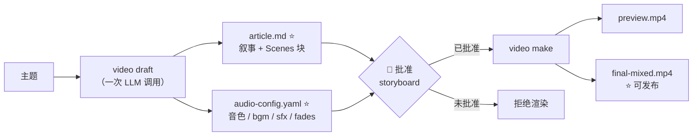
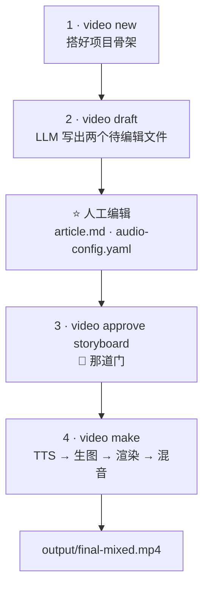
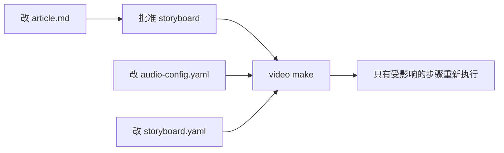

# AI Video Factory — 使用

如何从一个主题做出一个 1080p 成品视频。

- **还没装？** → [`docs/INSTALLATION.zh-CN.md`](./INSTALLATION.zh-CN.md)
- **想了解系统设计？** → [`docs/architecture.md`](./architecture.md)
- **想查分镜格式？** → [`docs/schema.md`](./schema.md)

本文覆盖：工作流、人工门、编辑与恢复、音频、图片、发布，以及文件结构。

> **关于命令块。** 本文说明每一步做什么、为什么这么做，不贴 shell 记录。
> 每一步都写明要敲的确切命令，你自己敲即可。想找可以直接复制运行的代码块
> 和离线 demo，见 [`README.md`](../README.md) 的 Quickstart。

---

## 1. 核心思路

整个系统的接口就是**两个 AI 命令加一次人工批准**。

一次 LLM 调用同时写出两个待人工编辑的文件。人来读、来批准，然后一条命令
渲染出视频。本文其余内容都是这三步的细节。



带星号的两个文件是**唯一**需要人工编辑的东西。项目里其他每个文件都由它们
推导而来。

批准这道门不是走形式的。storyboard 没批准之前，`video make` 会在渲染这一步
失败，并打印出确切的批准命令。直接调 `video preview --force` 可以绕过，但这
次绕过会记录进审计轨迹。

---

## 2. 推荐工作流

四条命令、两处人工编辑、一个产出。



### 2.1 搭骨架

`video new <id>` 建出项目目录和它的骨架：分镜模板、空的素材目录、运行记录与
检查点目录、输出目录，以及工作流状态文件。

项目初始状态是 `DRAFT`。工作流状态存在 `state.yaml` 里；每次工具调用都会在
`runs/` 下留一条记录。

### 2.2 起草

`video draft <topic>` 是唯一那次 LLM 调用。它写出：

- **`article.md`** —— 叙事正文，外加一个 `Scenes` 块，定义每一场的旁白和画面。
- **`audio-config.yaml`** —— 音色、BGM 标签、SFX 提示、淡入淡出。

它同时推导出 `storyboard/storyboard.yaml`（article 的 VDSL 形态），这样视频
长度跟随音频，而不是另外猜一个。

`video draft` 会在新生成的 article 上自动跑完音频规划这一步。两条护栏值得
记住：

- `--no-audio-plan` 跳过这一步，只要 article。
- 已存在的 `audio-config.yaml` **绝不**被覆盖——人工编辑优先。命令会打印一条
  提示，指明它保留了原有文件，并指向 `video audio-plan`。

如果音频规划的 LLM 调用失败，draft 仍然算成功，因为 `article.md` 才是主
产物。失败会以提示的形式出现，让你单独去跑 `video audio-plan`。

想从自己的想法出发，而不是从空白主题开始，就用 `--file <path>` 传一个文本
或 markdown 文件。LLM 把它当作**核心想法与观点种子**：它会润色措辞、结构和
行文，但绝不能改变你表达过的任何观点。（`--from` 则是修订已有草稿，两者互斥。）

#### 会改变渲染结果的 frontmatter

除基本项（`project`、`language`、`duration_target_sec`、`voice`）外，
`article.md` 里下面这些键会改变渲染产物：

| 键 | 作用 |
|---|---|
| `image_style` | 场景配图用的预设（`editorial`、`flat-vector` 等） |
| `image_provider` | `video make` 用哪个生图 API |
| `theme` | 分镜主题，由 `--style` 写入 |
| `require_visual_approval` | 为真时，`video make` 在图片集合被冻结前拒绝渲染 |
| `captions_source` | 字幕层烧什么内容：`narration`（默认）或 `caption` |
| `no_captions` | 为真时，完全不烧字幕层 |

> **英文稿请用 `captions_source: caption`。** 字幕层会按底部安全区校验——
> 三行、每行 24 个 CJK 单位，ASCII 按半个算——这让一场英文大约卡在 144
> 字符。英文旁白每场 150–220 字，所以默认的 `narration` 几乎每场都过不了
> 校验，渲染会被拒。`caption` 源改烧该场简短的 `caption:` 标签，任何语言都能
> 通过，而且不会让设计好的卡片把自己的文字在下面又印一遍。

### 2.3 批准

读 `article.md`——它已经镜像进 `storyboard.yaml`，所以你批准的就是会渲染的
东西。然后 `video approve storyboard --cwd <项目>`。

### 2.4 渲染

`video make <project>` 一条命令跑完整条渲染：文字转语音、音频素材、场景配图、
逐场渲染、最后混音。它是**幂等**的——输出比输入新的步骤会被跳过，所以编辑
之后重跑，只有受影响的部分会重新执行。
常用参数：

| 参数 | 作用 |
|---|---|
| `--dry-run` | 打印会跑什么、会跳过什么，不实际执行 |
| `--fake` | 完全离线：静音占位音频，不生图 |
| `--image-provider mock\|minimax\|openai\|gemini\|none` | 选生图后端；默认是 `minimax` |
| `--bgm-dir <目录>` | 用你自己的 BGM 库，而不是静音占位 |
| `--sfx-dir <目录>` | 用你自己的 SFX 库 |

`--fake` 是标准的离线模式。它同时跳过文字转语音（写静音占位 WAV）和真实
生图，场景保持 `AnimatedIllustration`——字幕加动画 SVG——所以不联网也能看到
完整的视频。只有当你就是想用占位图走一遍 `ImageBackground` 路径时，才需要
显式传 `--image-provider mock`。

#### 没有 API key？渲染仓库自带的 demo

`examples/mcp-explainer` 是确定性的，不需要任何 LLM key，只要 FFmpeg。
它会渲染 SVG 图解的 draw-on 效果外加手绘 canvas，并产出真实的 QA 报告。
完整可复制运行的命令块见 [`README.md`](../README.md) 的 Quickstart。

#### 项目参数的解析方式

每个接受项目参数的动词都用同一套宽容的方式解析，依次尝试：

1. 直接指向项目根目录的路径。
2. `projects/` 下的同名文件夹。
3. 人类可读的主题名，做 slug 化处理，且对大小写和分隔符不敏感——所以
   `"Harness Engineering"`、`harness_engineering` 和 `harness-engineering`
   找到的是同一个项目。
4. 唯一的文件夹名前缀。

前缀有歧义时会报错并列出候选；一个都没匹配上时会列出所有可用项目。

#### 落盘的产物

| 产物 | 是什么 |
|---|---|
| `output/preview.mp4` | 视觉预览 |
| `output/preview-faststart.mp4` | 同一份内容，加上 faststart 元数据以便流式播放 |
| `output/final-mixed.mp4` | 旁白 + BGM + SFX——**可发布成品** |
| `assets/audio/scene_*.wav` | 逐场文字转语音 |
| `assets/audio-assets/{bgm,sfx}/*.wav` | BGM 与 SFX 素材 |
| `captions/<lang>.srt` | 字幕 |
| `qa/render-report.json` | QA 报告，每次渲染都会写 |
| `qa/contact-sheet.png` | 逐场拼图，方便快速人工检查 |
| `scenes/` | 逐场 MP4 缓存 |

渲染是**逐场隔离**的：每一场先渲成自己的 MP4 片段，然后片段拼接。改第 7 场
只重渲第 7 场。`video preview --draft` 走低质量档（960×540@15）渲染到另一份
缓存；最终产物仍是 1080p30。

每次渲染结束都会出一份 QA 报告摘要，覆盖时长、帧率、分辨率、音频、黑帧、
素材、逐场音频同步、字幕和场景边界。error 级别的发现会让这一步失败。

---

## 3. 人工门

这些门是工作流状态，不是聊天里那句"请确认"。

| 门 | 命令 | 拦住了什么 |
|---|---|---|
| Storyboard | `video approve storyboard` | 没有它，`video preview` 和 `video make` 的渲染步骤会拒绝（`--force` 可绕过，且会记录） |
| Review | `video approve review` | 没有它，`video final` 拒绝执行 |
| Final | `video final`（QA 门） | error 级别的 QA 发现会拦住导出（`--force` 可绕过，且会记录） |

另外还有一道**阶段护栏**：生成类动词（`research`、`script`、`storyboard`、
`audio`、`motion`）在目标是人工已批准的阶段、或者项目已经是 `FINAL_APPROVED`
时，拒绝覆盖，除非加 `--force`（会打印成警告）。

典型迭代循环：



改叙事会重跑文字转语音和渲染。只改音频配置则只重跑音频素材和混音。改某一场
的组件则只重渲那一场，因为场景缓存会复用其余所有片段。

`video make` 的可发布产物是 `final-mixed.mp4`。走完整 agent 流水线的项目
以 `video final` 收尾，在 QA 与 review 两道门之后。

---

## 4. 场景级循环

场景是最小的可编辑单元，而且每一场都带版本历史。

| 命令 | 作用 |
|---|---|
| `video scene list <项目>` | 每场的版本列表，标出已批准的那一个 |
| `video scene approve <项目> <场 id>` | 记录你批准了哪个版本 |
| `video scene restore <项目> <场 id> <版本>` | 把某一场回滚到早先的版本 |

这正是整个系统存在的意义：一场 24 场的视频里，你只不满意第 9 场，代价是
重渲一场，而不是整个视频。

### 4.1 Remotion Studio 实时预览

`video studio <项目>` 在 Remotion Studio 里打开项目——一个基于浏览器的实时
预览，带时间轴和输入 props 编辑。Studio 的工作区每次启动都从分镜重新生成，
所以改过分镜后要重跑一次来刷新合成。

生成出来的工作区是一个真正的 Remotion 项目，因此 Studio 能做的（改 props、
拖帧）都作用于流水线真正的渲染实现。这是渲染任何 MP4 之前迭代画面最快
的办法。

### 4.2 恢复

| 命令 | 作用 |
|---|---|
| `video resume` | make 流程的项目重跑幂等流水线；CLI 流程的项目打印状态和确切的下一步命令 |
| `video rollback <检查点 id>` | 校验 id、把下游检查点标记为失效、落到 `DRAFT` 或目标阶段。绝不覆盖产物——内容回退走 `video scene restore` |
| `video reset [阶段] [--force]` | 回退。把目标检查点标记为失效，而不是伪造一个批准 |

### 4.3 关于手改 `storyboard.yaml`

`storyboard.yaml` 由 `article.md` 推导而来，每次 `video draft` 都会刷新。
`video make` 还会在文字转语音之后重写每场的 `duration:`，让它等于实测的
音频长度——不这样的话，渲染器会沿用 article 里规划的时长，在音频播完时
冻结在静帧上。

所以如果你手改 `storyboard.yaml`（换成 `Image` 组件、调整 props）：

- 逐场的 `duration:` 以及其他 `video draft` 推导出来的字段，会在下一次
  `video draft` 时被覆盖。
- 逐场的 `duration:` 也会在下一次 `video make` 时被覆盖，因为它要重新测量
  音频。
- 其余内容（组件选择、props、副标题）会保留下来——因为时长同步只动
  `duration:` 这一行。

两种受支持的流程：

- **叙事层面的调整** → 改 `article.md`，然后 `video draft` 会干净地重新生成
  `storyboard.yaml`。
- **像素级的美术指导** → 手改 `storyboard.yaml`，然后直接跑 `video make`。
  在你准备好放弃这些调整之前，**不要**重跑 `video draft`。

---

## 5. 分镜与 VDSL 格式

Schema 接受 `0.1` 和 `0.2` 两个版本；0.2 的字段都是可选的，两个版本都能通过
校验。权威参考是 [`docs/schema.md`](./schema.md)——实现是严格模式的 zod，
所以任何位置的未知键都会被拒绝，校验错误带 YAML 行号。

时长单位是**秒**；编译器用时长乘帧率再取整来换算成帧数。

### 5.1 分镜的结构

一个分镜由 project 块、可选的 style 块、可选的素材清单，以及一个场景列表
组成。每个场景带 id、时长、旁白、画面、动画、字幕设置和转场。

完整带注释的示例见 [`docs/schema.md`](./schema.md)。最容易踩到的规则：

- `schema_version` 必须是 `0.1` 或 `0.2`（省略时默认 `0.2`）。
- 场景 id 必须唯一。每场需要正数时长，以及一个已注册的视觉组件。
- 组件必须在注册表里，props 必须通过该组件自己的 schema。
- 旁白音频文件必须存在，且不得超过该场时长（容差 0.05 秒）。`video preview`
  和 `video make` 会在校验前把时长同步到实测音频，所以先跑其中一个。
- 字幕必须折行到不超过三行、每行 24 个 CJK 单位——底部安全区。
- 时间线动画必须落在场内：起始时间加时长不得超过该场自身的时长。
- LLM 的同义词会在校验前被归一（`wipe` 变成 `draw`，`hand-drawn` 变成
  `canvas`，`dissolve` 变成 `fade`）。真正未知的值会响亮地失败。

### 5.2 渲染器家族

| `visual.renderer` | 组件 | 说明 |
|---|---|---|
| `remotion` | 任何经典注册表组件 | 默认 |
| `canvas` | `DoodleScene` | 手绘墨迹、种子抖动、节拍同步 |

未接线的渲染器与组件组合会在渲染时响亮地失败。

### 5.3 主题

`style.theme` 从九套内置配色里选一套。默认是 **`paper-light`**。未知或缺失
的值同样回落到 `paper-light`，所以拼错主题名也不会让渲染崩掉——而且
`video validate` 会给出提示。

用 `video draft --style <名字>` 设置，或直接写进 `style:` 块。`video theme`
打印带色块的主题索引，`video theme <名字>` 打印单套配色，`video theme --cwd
<根目录>` 解析某个项目当前用的主题。

<!-- BEGIN: theme-table (generated by `pnpm run docs:commands` — do not edit) -->

| `style.theme`      | Background   | Accent         | Mood / best for                                                              |
| ------------------ | ------------ | -------------- | ---------------------------------------------------------------------------- |
| `paper-light`      | warm paper   | orange         | **default (v0.4.3)** — hand-drawn / bright office / pairs with `DoodleScene` |
| `dark-tech`        | deep navy    | blue           | tech explainers (default prior to v0.4.3)                                    |

<!-- END: theme-table -->

完整配色表见 [`docs/schema.md`](./schema.md)。

---

## 6. 语音、字幕与音频

### 6.1 全部并入 `video make`

推荐路径没有独立的音频步骤。`video make` 合成旁白、解析 BGM 与 SFX 提示、
写出字幕，最后混成 `final-mixed.mp4`。

### 6.2 句间停顿

在 `audio-config.yaml` 里设 `pause_between_sentences_sec`，即可在句子之间
插入停顿。这个值属于文字转语音缓存键的一部分，所以改了它会重新合成受影响的
场，而不是拿旧音频来糊。

### 6.3 音色选择

`audio-config.yaml` 里的 `voice:` 指明音色，`tts_provider:` 指明后端：

| Provider | `voice:` 是什么 | 要求 | 速度 |
|---|---|---|---|
| `voicebox` | Voicebox 的 profile 名或 id | 本地 voicebox-server（`VOICEBOX_URL`，默认 `127.0.0.1:17493`） | Qwen3-TTS，在 Apple Silicon 上约比实时慢 7 倍 |
| `minimax` | MiniMax 的 `voice_setting.voice_id` | `MINIMAX_API_KEY`。声音克隆需要按量付费的 key——Token Plan key 会报 2061 | 约比实时快 2.5 倍 |
| 省略，或 `edge` | Edge TTS 的音色 id，例如 `zh-CN-YunjianNeural` | 无需任何配置——微软的免费端点 | 大致实时 |

Edge TTS 是默认，因为它既不要 key也不要本地服务。

### 6.4 用克隆音色配音（Voicebox）

在 article 的 frontmatter 里设 `tts_provider: voicebox`，并把 `voice:` 指向一个
Voicebox 音色 profile。Provider 会连本地 voicebox-server、轮询异步任务、
写回返回的 WAV；时长同步随后按实测音频重写场景时长。

Apple Silicon 上的 Qwen3-TTS 1.7B 约比实时慢 7 倍。按每 180 秒旁白约 20 分钟
机器时间来预估——每次改旁白付一次，因为缓存按 provider 做了命名空间隔离。

### 6.5 BGM 与 SFX

`audio-config.yaml` 里的标签（`bgm: calm`、`sfx: {scene_1: whoosh}`）会解析
成你通过 `--bgm-dir` 或 `--sfx-dir` 传入的目录里的同名文件——先找精确同名，
再找任何名字里含该标签的 `.wav`。

不传这两个参数时，音频素材步骤会写一个 1 秒的**静音 mock 占位**。混音机制
照常运行——只是你在给静音做闪避。传了参数，真实音频会落到
`assets/audio-assets/`，混音把它叠在旁白下面，闪避大约 18 dB。同名的
`.license.txt` 会记录在 make 报告里，出处可见。标签找不到时，音频素材步骤会
报出可读的错：把文件补上，或者去掉这个提示。

BGM 没有 provider 服务。标签解析到 `assets/bgm/` 里的精选库，`music.json` 为
它记录实测时长、响度、动态范围和场景备注。项目本地的
`assets/audio-assets/bgm/` 会遮蔽工作区库。

---

## 7. 图片与视觉护栏（v0.8）

### 7.1 内容键控的图片与影响表

每个 `assets/images/scene_N.jpg` 旁边都有一个 `scene_N.cache.json` 边车文件，
记录它的输入哈希——该场的视觉行、图片风格、provider、几何参数。改动其中任何
一个，陈旧的图片会在下一次 `video make` 时被删掉并重新生成。v0.8 之前，
改过的视觉行根本传不到画面上，因为缓存只按文件是否存在来判断。边车文件出现
之前的图片会被**收养**——保留并建键——所以升级不会重复花钱。

渲染层有同样的性质，只是高一层。每一场缓存的 MP4 按该场自身的内容摘要建键，
所以重新生成的场景图会自动让那一场的缓存视频失效。dry-run 影响表和真正的
渲染通过同一个 helper 计算这个摘要，因此两者不可能对"什么会重渲"产生分歧。

花钱之前先用 `video make <项目> --dry-run` 预览影响范围。表格会报告多少张图
要重生成、多少张命中缓存、多少场会渲染、是哪几场——还会报出分镜漂移，即
article 的旁白改了、而按 id 同步的分镜文本还是旧的。

### 7.2 关键帧审核（可选开关）

在 article 的 frontmatter 里加 `require_visual_approval: true` 就能打开图片
审核循环：

| 命令 | 作用 |
|---|---|
| `video visuals <项目>` | 生成场景配图和拼图 |
| `video visuals <项目> --reject <编号> --reason "..."` | 强制重新生成某一场 |
| `video approve visuals <项目>` | 冻结这批图 |
| `video make <项目>` | 只在集合一致时才渲染 |

`video visuals` 会写出 `assets/images/contact-sheet.png`——一张带编号角标和
标题文字的整页拼图。`video approve visuals` 把每张图的哈希写进
`checkpoints/visuals.yaml`。开关打开后，只要 checkpoint 缺失或过期，
`video make` 会拒绝渲染并指出过期场景。

工作流状态机不受影响——这道门是一份 checkpoint 记录，不是新阶段。

---

## 8. 角色圣经

**角色圣经**是跨集共享的角色库：保存角色的身份、外观变体和经审核的参考图。
它放在工作区根目录的 `assets/characters/`，而不是某个项目内部——圣经的意义
就在于跨片复用。

每个角色有一份 `character.yaml`——姓名、身份、外观变体、参考图记录——外加一个
`refs/<style>/<version>.jpg` 目录，按画风各存一份参考图。

| 命令 | 作用 |
|---|---|
| `video character list` | 列出全部角色及其参考图 |
| `video character sheet <id> <style>` | 生成一张**候选**参考图 |
| `video character approve <id> <style> <version> --by <名字>` | 把候选提升为该画风的**正式角色参考** |

`sheet` 直接用档案里的关键视觉锚点拼提示词，中间没有 LLM。参考图必须忠实
还原锚点——一个"优化"过描述的扩写器反而会毁掉这件事：参考图正是用来核对
锚点的。加 `--provider mock` 可以离线生成。

`approve` 是一个有记录的动作。它记下谁在什么时候审核了这张图，并把同画风的
上一张正式参考图标记为被取代（文件仍留在磁盘上），而不是覆盖它。如果参考图
文件不存在，审核会被拒绝：批准一张缺失的图片会让正式素材不可用，而这个问题
要等到生成画面时才会暴露。`--by <名字>` 是必填项——没有审核人的批准不算审核。

参考图不会被覆盖。新图会取该画风下下一个空闲的 `vN` 版本号。

### 8.1 场景如何使用角色圣经

图片模型不接受参考图，所以关键视觉锚点文字**就是**一致性的机制。引用了某个
角色的场景，会把该角色的锚点带进图片提示词；同一份解析后的锚点也参与提示词
缓存键的计算——所以改了锚点就会让缓存失效，而不是悄悄重放旧画面。

没有档案的角色不贡献任何锚点。这不是错误：某一场可能提到一个还没有角色档案
的人。

---

## 9. 品牌与营销

工作区根目录的 `brand.yaml` 是一份签入仓库的人工决策文件：频道名称和图标。
编排器尊重它，生成过程则从解析出的配置确定性地产出。仓库自带一份默认值——
"AI 视频工厂"和一个占位图标。

具名 BGM 曲目来自 `assets/bgm/` 里的精选库，`music.json` 为它记录实测时长、
响度、动态范围和场景备注。

---

## 10. 可选的 AI 工作流

AI 类命令使用 MiniMax 和 GLM 兼容的 API。对本地渲染路径来说它们是可选的
——第 2 到第 4 节的内容都不需要它们。

凭据放在 shell 环境变量里；绝不提交进仓库。

### 10.1 Provider 降级

每个 AI 命令在遇到配额和限流错误时都会降级到配置的备用 provider——HTTP 429、
402、403，或者响应体里含 `insufficient_balance`、`quota_exceeded`。实际服务的
provider 会记录在 `runs/<run-id>.yaml` 里，方便你审计降级是否触发。

按命令用 `--model <provider>` 覆盖路由，或全局通过 `LL_CONFIG` YAML 文件
配置。

### 10.2 编程代理问题协议

`video-ask/1` 是让 agent harness 向人提问的协议。当 harness 能弹窗提问时
——OpenCode、pi、Claude Code 等——draft 命令就在那里问，而不是自己猜。

规则：

- 每次最多问四个问题，推荐项排第一并标注。
- 最多两批，这样长回答不会变成审讯。
- 代理绝不自动批准人工门。它把产物亮出来，然后发问。
- `--ask` 即使没有检测到 harness 也强制走协议；`--no-ask` 从不发问，直接
  接受默认值。

问题覆盖文章的受众、语言、时长、图片风格、生图 provider、主题、BGM 和音色。
`video ask` 可以查看当前的问题集。

### 10.3 完整 agent 流水线

细粒度的动词仍然存在，供希望把每一步拆开用的项目。它们为兼容旧项目而保留，
不在推荐路径上。

| 动词 | 作用 |
|---|---|
| `video research` | 联网调研 → `research/` 下的来源与论断 |
| `video script` | 脚本 → `script/script.<lang>.md` |
| `video storyboard` | 从调研或脚本生成分镜 |
| `video motion` | 逐场时间线动画与转场 |
| `video audio` | 文字转语音 + 字幕 |
| `video audio-asset` | BGM 与 SFX 素材 |
| `video mix` | 单独跑混音步骤 |
| `video review` | 内容、视觉、技术三类审核 YAML |
| `video qa` | 为当前预览重建 QA 报告 |
| `video validate` | 按完整规则校验分镜 |

---

## 11. 发布

发布元数据不属于 `video make`，要单独调用。

| 命令 | 产物 |
|---|---|
| `video youtube <项目>` | YouTube 发布包：标题、描述、章节 VTT、缩略图提示、Shorts hook |
| `video thumbnail <项目>` | 1280×720 缩略图——默认 mock，加 `--provider minimax` 走真实 AI |
| `video shorts <项目>` | 从 `final-mixed.mp4` 抽出的竖屏 9:16 短片 |
| `video bilibili <项目>` | B 站发布包：标题、简介、标签、建议分区、封面提示，以及人工投稿清单 |

`video youtube` 优先读 `article.md`，从中推导标题、hook、章节和章节时间点。
当 `article.md` 不存在时，回退到旧的 `research.md` + `script.md` +
`storyboard.yaml` 三件套。

B 站没有面向第三方工具的公开视频上传 API，所以 `video bilibili` 只做打包
——产出元数据和一份清单，上传由人来做。这里有一条值得知道的决定：
`suggested_category` 是分区**名称**，不是数字 id。填错数字 id 不会报错——
它会把视频归进毫不相干的分区，而且要到发布之后才会有人发现。填一个能对着
下拉框核对的名称，则会响亮地失败。

YouTube 也支持直接上传——发布包里带元数据，上传路径处理 YouTube 要求的
OAuth 验证。该流程的当前状态见发布说明。

---

## 12. 项目结构与可追溯性

```text
projects/<slug>/
├── project.yaml                     项目元数据
├── article.md                       ⭐ 人工编辑：叙事 + Scenes 块
├── audio-config.yaml                ⭐ 人工编辑：音色 / bgm / sfx / fades
├── storyboard/storyboard.yaml       由 article.md 推导；逐场时长在 TTS 后重测
├── vdsl/vdsl.yaml                   归一化编译后的 VDSL（确定性）
├── state.yaml                       工作流状态机（10 个状态）
├── checkpoints/<stage>.yaml         人工门的审计轨迹
├── checkpoints/visuals.yaml         v0.8 开关打开时冻结的图片集合
├── runs/<run-id>.yaml               每次 LLM 与工具调用的运行记录
├── scenes/                          逐场 MP4 缓存（按内容摘要建键）
├── scenes-draft/                    低质量草稿缓存（960×540@15）
├── qa/
│   ├── render-report.json           QA 报告，每次渲染都会写
│   └── contact-sheet.png            逐场拼图
├── assets/
│   ├── audio/scene_*.wav            逐场 TTS
│   ├── audio-assets/{bgm,sfx}/      BGM 与 SFX 素材
│   ├── images/scene_N.jpg           场景图 + 其输入键边车文件
│   └── images/contact-sheet.png     v0.8 的审核拼图
├── captions/<lang>.srt              字幕
├── youtube/                         发布包
├── bilibili/                        B 站发布包与投稿清单
└── output/
    ├── preview.mp4
    ├── preview-faststart.mp4
    └── final-mixed.mp4              ⭐ 可发布成品
```

带星号的文件是两个待人工编辑的文件；其余全是推导出来的。

每条 `runs/<run-id>.yaml` 记录都带有 provider、模型、输入与输出的 token 数、
提示词哈希、预估美元成本、输入输出文件引用，以及 ISO 时间戳。

**绝不**提交 API key、`.env`、私有素材、token 或 cookie。

---

## 13. 常见问题

### `video make` 提示 storyboard 未批准

渲染步骤有门禁。读 `article.md`（它已镜像进 `storyboard.yaml`），然后用
`video approve storyboard --cwd <项目>` 批准。错误信息会打印出要敲的确切
命令。

### `video make` 提示文件缺失

`video make` 需要项目目录里同时有 `article.md` 和 `audio-config.yaml`。
错误信息会针对每个缺失文件给出提示。缺 `article.md` 就跑 `video draft
<主题>`——它一次写出两个文件。只缺 `audio-config.yaml` 就跑 `video audio-plan
<项目>`。

### `video final` 被 QA 门拦下

QA 报告里有 error 级别的发现。读 `qa/render-report.json` 看细节，门会指出
具体是哪几项检查。修好底层问题后重跑，或者加 `--force`——绕过会记进审计
轨迹。

### article 里的场景旁白是空的

`article.md` 的 `Scenes` 块承载每场的旁白。旁白为空说明这个块缺失，或某场
的 `text` 字段是空的。重新跑 `video draft` 重新生成，或者手工填上。

### 英文内容让字幕层校验失败

在 article 的 frontmatter 里设 `captions_source: caption`。见
[第 2.2 节](#22-起草)。

### Edge TTS 失败

Edge TTS 需要能访问微软的免费端点。网络不通时，走完全离线的路线：`--fake`
出静音占位音频，或者在 article 的 frontmatter 里用 `tts_provider:` 换
provider。

### 视频在静帧上卡住

某一场的 `duration:` 比它的音频短。`video make` 会在文字转语音之后重新测量
时长并改写分镜，所以要重跑 `video make`，而不是手改时长。

### 旁白比视频长

这是音频驱动的时长行为。容器会宣告更长的音频时长，而视频流提前结束，最后
几帧就播放成一张冻结的末帧。音频混音步骤从分镜读取场景列表——分镜才是
"存在哪些场、什么顺序"的权威——所以一次缩短视频的重写不会留下多余音频。
真遇到了，就在重写之后重跑 `video mix`。

### Remotion 无法找到端口

端口被别的进程占了。`video studio` 可以用 `--port` 换一个。

### 校验提示素材不存在

像 `assets/audio/scene_01.wav` 这样的路径是相对**项目根目录**的，不是相对
放着 YAML 文件的那个目录。检查路径，并给 `video validate` 传上项目根目录作为
`--root` 参数。

---

## 14. 验证整条链路

`pnpm run acceptance` 会在基准项目上跑 §62.4 审计——一段 39 秒、讲解 AI
思维链的中文短片。审计检查文件格式、运行时和可追溯性，全程不需要 AI，并且
会真的渲染视频，所以需要 FFmpeg 和 ffprobe。

跑成功后会看到十一项检查全部通过。

`examples/` 下有三个完整的示例项目，不需要任何 API key，覆盖全部能力。它们是
确定性的，所以也能当固定样例用：

| 示例 | 时长 | 覆盖内容 |
|---|---|---|
| `examples/mcp-explainer` | 45 秒 | 完整流水线：图解 draw-on、显式动画、手绘 canvas、时长同步、场景版本、QA 报告与门禁 |
| `examples/ai-concept` | 60 秒 | 手绘 canvas 与 100 BPM 网格上的节拍同步 |
| `examples/devops-architecture` | 90 秒 | 图解、硬切与淡入淡出转场、时间线编排 |

每个示例的 `README.md` 都记录了场景——哪个组件家族配哪个流水线特性。已提交的
集成测试会在临时项目上跑这一模一样的序列，所以示例不会在无人察觉的情况下
和代码脱节。

---

## 下一步

- 完整的分镜格式：[`docs/schema.md`](./schema.md)
- 系统设计：[`docs/architecture.md`](./architecture.md)
- 工作流门禁与不变量：[`docs/workflow.md`](./workflow.md)
- 每个版本改了什么：[`docs/RELEASES.md`](./RELEASES.md)
