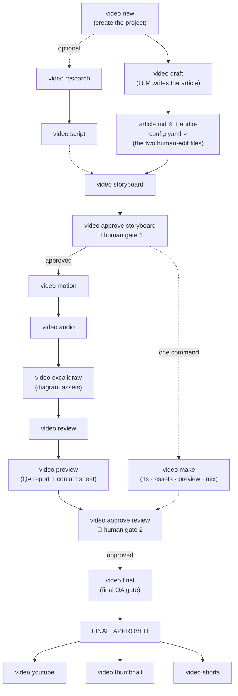
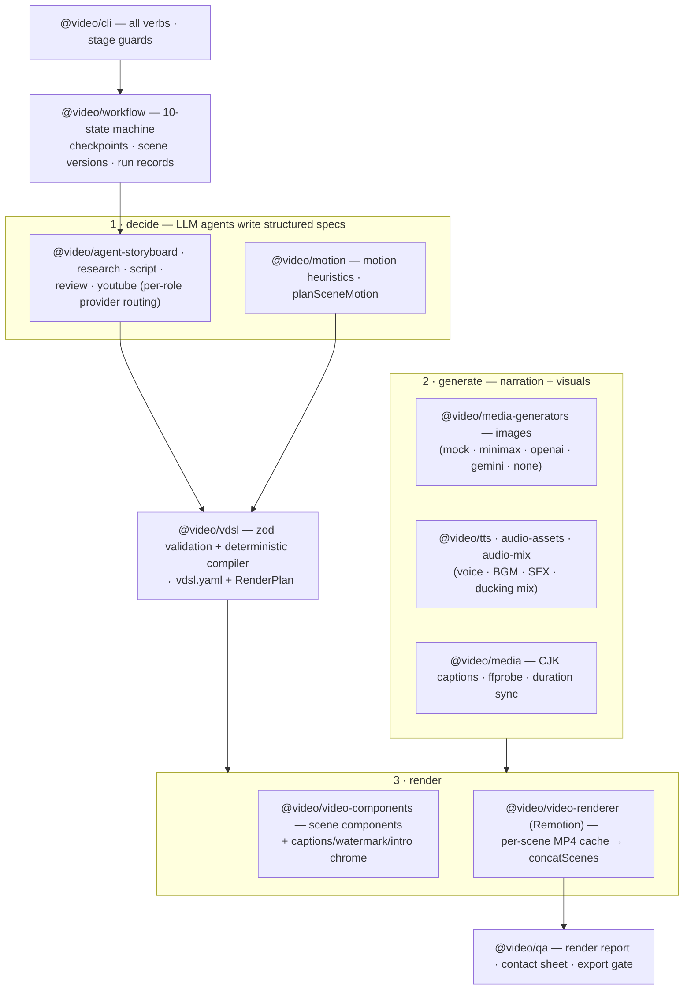

# Architecture — AI Video Agent (v0.6.0: decision layer)

The design source is `docs/ai-video-agent-development-plan-v0.2.md`; the
traceable task plan is `docs/ai-video-agent-design-and-tasks-v0.2.md`;
the v0.1 codebase mapping lives in `docs/architecture-v01-map.md`.
This document describes the system AS BUILT — v0.6.0 (v0.6 Laya
decision layer shipped with `LAYA_MODE` default off).

## Principles (plan §29)

1. **Scene is the minimal editable unit** — scenes render to their own MP4
   cache (`scenes/`, `scenes-draft/`), keyed by fragment content hash;
   editing scene-007 re-renders only scene-007.
2. **Third-party skills never reach the core data model** — `@video/motion`'s
   `IartSkillAdapter` is the only reader of `.agents/skills/`; skill
   formats never leak into VDSL.
3. **Remotion is the renderer, not the planner** — agents produce
   structured specs; Remotion rasterizes.
4. **Human approval is workflow state** — `checkpoints/<stage>.yaml` with
   status approved/rejected/invalidated; preview is gated on an approved
   storyboard; final is gated on QA + review approval.
5. **AI generates · Human decides · Code renders · Git remembers**
   (plan §65) — the two human-edit files (`article.md` and
   `audio-config.yaml`) are the only files a user must hand-edit.
   Image generation follows the same pattern: `brand.yaml`
   (workspace-root) is a checked-in human-decision file the
   orchestrator respects; the actual generation runs deterministically
   off the resolved config.
6. **Image providers are HTTP APIs** — scene images come from a hosted
   provider (`minimax`, `openai`, `gemini`), each selected with
   `--image-provider` and authenticated by its own env var. `mock`
   gives deterministic placeholders; `none` skips image generation.
7. **Local decisions are advisory** (v0.6) — the Laya decision-model
   sidecar (bounded `choice`/`score`/`noul` answers, NOT a chat
   model) may pre-screen, annotate, and log, but never replaces a
   human gate, never drives a workflow transition, and degrades to
   exactly the pre-v0.6 behavior on any failure
   (`LAYA_MODE=off|shadow|on`, default off; plan:
   `docs/v0.6-laya-decision-integration-plan.md`).

## The pipeline

For end users — the full command flow. Everything between the two 🚪
gates is also driven by a single `video make` (see below).



```text
video new → (research → script →) storyboard → approve storyboard (GATE)
      → motion → audio → excalidraw (assets) → review
      → preview (QA report + contact sheet) → approve review (GATE)
      → final (QA gate) → FINAL_APPROVED → youtube / thumbnail / shorts
```

`video make` runs the compressed article.md-driven version of the same
pipeline (draft → tts → assets → preview → mix) and stops at the same
storyboard gate. Every render writes `qa/render-report.json` +
`qa/contact-sheet.png`.

The scene-visual step (within `generateSceneVisuals`) is one HTTP
request per scene to the selected provider, returning JPEG bytes
that are written to `assets/images/scene_N.jpg`.

## Packages (plan §32 aliases in parentheses; v0.5.2 additions marked)

How the packages fit together — decide, then generate, then render,
then check:



The table below is the detailed reference (§32 aliases in
parentheses; v0.5.2 additions marked):

| Package | §32 alias | Role |
|---|---|---|
| `@video/llm` | llm | chat providers (GLM, MiniMax) with per-role routing + bounded retry/fallback; v0.6 `LayaClient` (advisory bounded decisions from the local laya-serve sidecar, `LAYA_MODE=off\|shadow\|on`) + the `laya-decisions.jsonl` sidecar writer |
| `@video/vdsl` | schema | VDSL 0.1/0.2 zod schema, validator (line-numbered errors), deterministic compiler → `vdsl/vdsl.yaml` + `RenderPlan` |
| `@video/motion` | motion | IartSkillAdapter, motion heuristics, deterministic `planSceneMotion`, Motion Agent (`callMotionAgent`) |
| `@video/agent-storyboard`, `@video/research`, `@video/script`, `@video/review`, `@video/youtube` | agent | LLM agents (per-role provider routing incl. `motion`, transient retry, quota fallback) |
| `@video/video-components` | renderer | 24 scene components in `REGISTRY` incl. `SvgScene` (whiteboard/diagram + camera) and `DoodleScene` (canvas hand-drawn + beat-sync); chrome overlays (`CaptionsOverlay`, `BrandWatermark`, `BrandIntro`); 9 `style.theme` palettes; 5 intro gradients; animation/easing/doodle/excalidraw logic. |
| `@video/video-renderer` | remotion | scene-isolated Remotion rendering (`renderSceneToVideo`, `concatScenes`), draft mode, studio workspace generator |
| `@video/media` | assets | CJK caption wrap, ffprobe, duration sync (`syncSceneDurations`), scene-timing reader |
| `@video/media-generators` | images | `ImageProvider` + `VideoProvider` abstractions; `MockImageProvider`, `MiniMaxImageProvider` (**default since v0.8.1**), the OpenAI and Gemini image providers, `MiniMaxVideoProvider`. |
| `@video/tts`, `@video/audio-assets`, `@video/audio-mix` | audio | Edge TTS (+word timestamps), BGM/SFX providers, ducking/fades mix engine |
| `@video/qa` | qa | render report (duration/fps/resolution/audio/black-frames/assets/scene-audio-sync/captions/boundaries), contact sheet, export gate |
| `@video/workflow` | (agent state) | 10-state machine, checkpoints + invalidation, scene version store, run records |
| `@video/cli` | cli | all verbs (`video`), stage guards, state-machine wiring |
| `skills/`, `.agents/skills/` | skills | first-party + installed skill packs (`skills/INVENTORY.md`) |

## Visual renderer families (plan §9)

| `visual.renderer` | Components | Status |
|---|---|---|
| `remotion` | all classic REGISTRY components | wired |
| `svg` | `SvgScene` (diagram spec: nodes/edges, draw-on, target-driven camera) | wired (T4.3) |
| `canvas` | `DoodleScene` (ink strokes, seeded wobble, beat-sync) | wired (T4.4) |
| `excalidraw` | — | asset generator only (`video excalidraw` → `.excalidraw` + animated `.svg`, T7.1); not a render path |

Unwired renderer/component combinations fail loudly at render time.

## Determinism

- The compiler is pure (no clock/locale/fs order); re-compiling emitted
  vdsl.yaml is byte-identical (tested).
- Scene caches key on fragment content hash + narration audio state.
- Canvas/SVG drawing is a pure function of the frame: seeded PRNG
  (`rng(seed)`), never `Math.random`/`Date` (javascript-animation skill
  contract).
- `bundle({ enableCaching: false })` — Remotion's persistent webpack cache
  must be disabled IN THE BUNDLER OPTIONS (a `webpackOverride`
  `cache: false` is silently overwritten by Remotion and leaked 69 GB).

## Demos (plan §35)

| Demo | Example | Exercises |
|---|---|---|
| MCP Explainer (45 s) | `examples/mcp-explainer` | full pipeline, svg diagrams, canvas, QA, excalidraw, final gate |
| AI Concept (60 s) | `examples/ai-concept` | hand-drawn canvas, beat-sync (100 BPM grid) |
| DevOps Architecture (90 s) | `examples/devops-architecture` | diagrams, target-driven camera, cut/fade transitions, timeline choreography, excalidraw |
